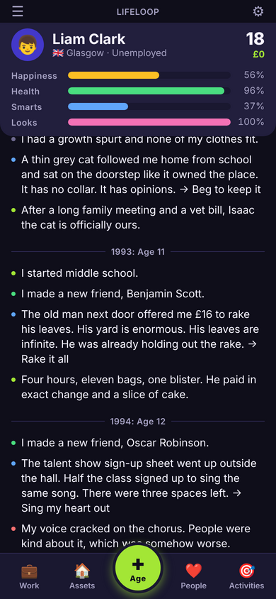
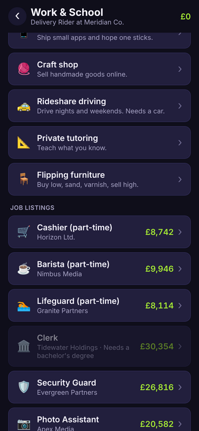
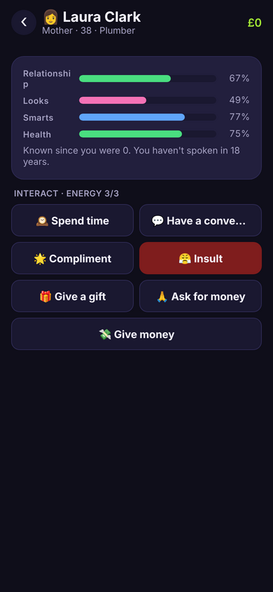
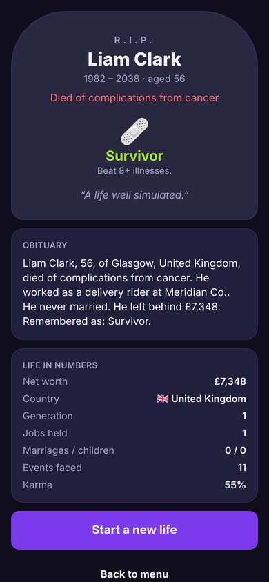

# LifeLoop (working title) — a text life simulator for iOS and Android

> **Name before you ship:** "LifeLoop" is a placeholder and likely collides with an existing software brand. `docs/RELEASE_CHECKLIST.md` lists every place to change it.

LifeLoop is a BitLife-style life simulator built with **Expo (React Native) + TypeScript**. You are born into a random family and country, tap once per year, and face hand-written events with real consequences until you die, earn a ribbon, read your auto-generated obituary, and continue as your child.

The game engine is a **pure, deterministic TypeScript simulation** with no React or native dependencies, so it is unit-tested, replayable from a seed, and extended by adding data, not code.

| Life screen | Work & School | A person | Tombstone |
| --- | --- | --- | --- |
|  |  |  |  |

_Screenshots are captured automatically from the web export by `npm run e2e`._

## Quick start

```bash
npm ci
npm run web          # play in the browser (Expo web, hot reload)
npm run start        # Expo dev server for a device/simulator (Expo Go works; ads/IAP are no-ops there)
npm test             # engine unit + property tests (simulates hundreds of lives)
npm run typecheck && npm run lint
npm run build:web && npm run e2e   # static web export + scripted Playwright playthrough with screenshots in e2e/screenshots/
npm run balance      # plays hundreds of seeded lives per play style and prints the economy and ribbon numbers against the design targets
```

Real ads and purchases need a development build: `eas build --profile development --platform all`.

## Live web preview

Every push to `master` or `claude/bitlife-clone-mvp-8ogicm` builds the web version, plays it through with Playwright, and publishes it to the `gh-pages` branch (`.github/workflows/preview.yml`). Turn it on once in **Settings → Pages → Build and deployment**: Source **Deploy from a branch**, branch **gh-pages**, folder **/ (root)**. The game is then playable at **https://jaedonh.github.io/BitLife/** and saves in the browser. Ads and purchases are switched off on the web.

## What is in the MVP

- **Core loop:** four stats (Happiness, Health, Smarts, Looks), money, hidden karma; Age+ advances one year with stat drift, finances, school, career, relationships, health and mortality; events pop up as choice cards.
- **Education:** auto-enrolment by country, grades, study/skip/drop out, 25 majors, graduate programs, scholarships, student debt.
- **Careers:** 71 job ladders across 13 categories with requirements, interviews, performance, raises, promotions, layoffs, retirement; 6 side hustles.
- **Relationships:** parents, siblings, friends, lovers, spouses, children, pets; 14 interactions; relationship decay and NPC memory; marriage, children, divorce, inheritance.
- **Assets and money:** cars, homes (mortgages, rent-out), luxury items, savings/index/crypto investing, debt, taxes, bankruptcy.
- **Activities:** gym, library, meditation, salon, surgery, doctor, therapy, rehab, parties, vacations, volunteering; 7 crimes with arrest, fines and prison.
- **Death and legacy:** mortality model, 26 ribbons, generated obituary and epitaph, continue as an heir, graveyard.
- **Content:** data-driven events (`src/data/events/*`) validated by tests and `scripts/validate-events.ts`.
- **Monetization:** AdMob banner/interstitial/rewarded behind a pure cadence policy (grace period, every-N age-ups, cooldown, session cap, daily rewarded caps) and a single RevenueCat one-time **Premium** entitlement (no ads, custom stats, unlimited generations, instant second chance; $4.99). Everything degrades to no-ops on web and in Expo Go.
- **Store readiness:** icons and store art (`scripts/generate-icons.sh`), variant-aware `app.config.ts` (sample AdMob IDs outside production), SKAdNetwork ids, UMP consent + ATT, iOS privacy manifest, `eas.json`, GitHub Actions CI, privacy policy, listing copy and a release checklist in `docs/`.

## Project layout

```
app.config.ts          Expo config (variants, plugins, privacy manifest)
src/app/               expo-router screens
src/components/        UI primitives and game components
src/engine/            pure simulation: types, rng, events, systems, ageUp, actions, simulate (test harness)
src/data/              content tables: countries, names, jobs, majors, activities, assets, hustles, crimes, illnesses, events/
src/store/             zustand stores + persistence + migrations
src/services/          ads (AdMob), purchases (RevenueCat), storage, monetization bootstrap
docs/                  GAME_DESIGN, ARCHITECTURE, PRIVACY_POLICY, STORE_LISTING, RELEASE_CHECKLIST
e2e/                   Playwright playthrough against the web export
scripts/               icon generation, event validator, balance report, privacy-URL check
legacy/                the original Python prototype
```

## Adding content

1. Add events to a file in `src/data/events/` (see `childhood.ts` and `src/engine/events/schema.ts`), export the array and spread it in `src/data/events/index.ts`.
2. `npx tsx scripts/validate-events.ts src/data/events/<file>.ts` checks the schema, placeholders, follow-ups and reachability; `npm test` validates the whole registry and re-simulates lives.
3. Jobs, majors, activities, assets, hustles, crimes, illnesses, countries and names are plain tables in `src/data/`.

## Releasing

Follow `docs/RELEASE_CHECKLIST.md`. In short: create AdMob and RevenueCat apps, publish the privacy policy, set the EAS production variables (the six `EXPO_PUBLIC_ADMOB_*` unit IDs, `ADMOB_ANDROID_APP_ID`, `ADMOB_IOS_APP_ID`, `EXPO_PUBLIC_RC_IOS_KEY`, `EXPO_PUBLIC_RC_ANDROID_KEY`, `EXPO_PUBLIC_PRIVACY_URL`, `EXPO_PUBLIC_SUPPORT_EMAIL`), then `eas build --profile production` and `eas submit`. A production build refuses to start while any of these is missing or still a sample or placeholder value, and fails if the privacy policy URL is not live. Answer the content questionnaires as documented and start the Play closed test early.

## License

MIT (see `LICENSE`). The original Python prototype this repository started from is kept in `legacy/`.
